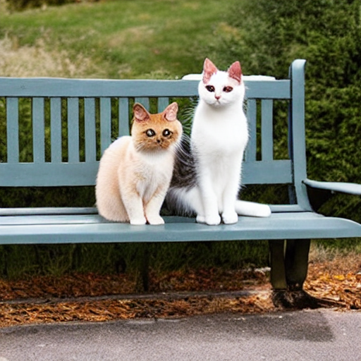
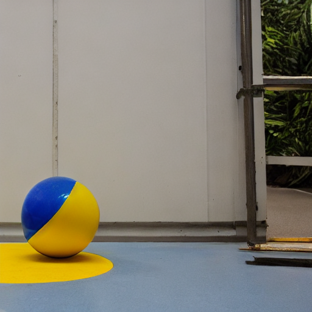
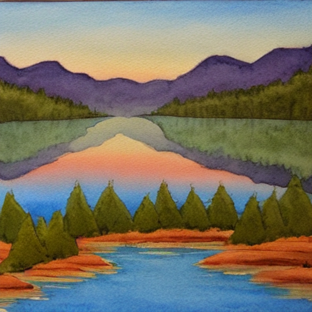
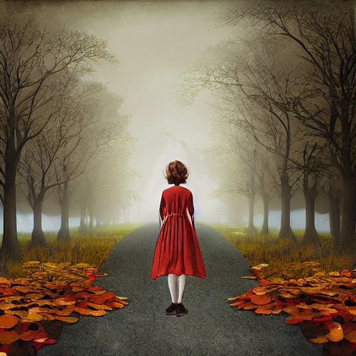

# Milestone 1 - Baseline prompt->image runs

Model: `stable-diffusion-v1-5/stable-diffusion-v1-5` | Scheduler: PNDMScheduler | Seed: 42 | Steps: 30 | Guidance: 7.5

### p1_simple_object
**Prompt:** a red apple on a wooden table

### p2_multi_object
**Prompt:** a cat and a dog sitting together on a park bench

### p3_spatial
**Prompt:** a blue cube to the left of a yellow sphere on a white floor

### p4_stylistic
**Prompt:** a mountain lake at sunrise, in the style of a watercolor painting

### p5_abstract
**Prompt:** the feeling of nostalgia, surreal dreamlike digital art

